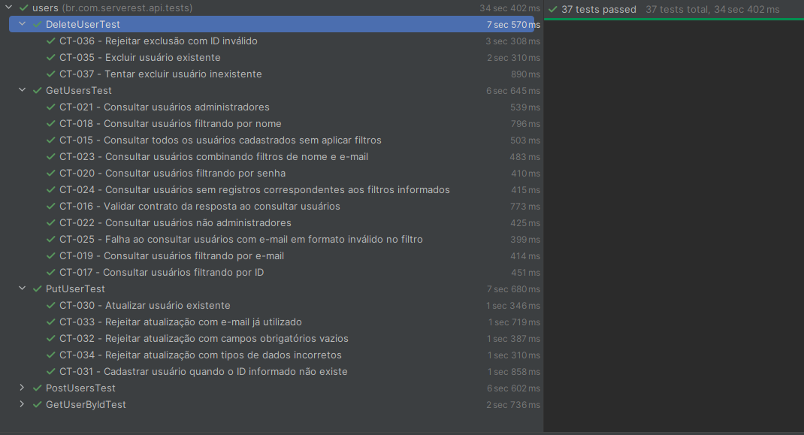
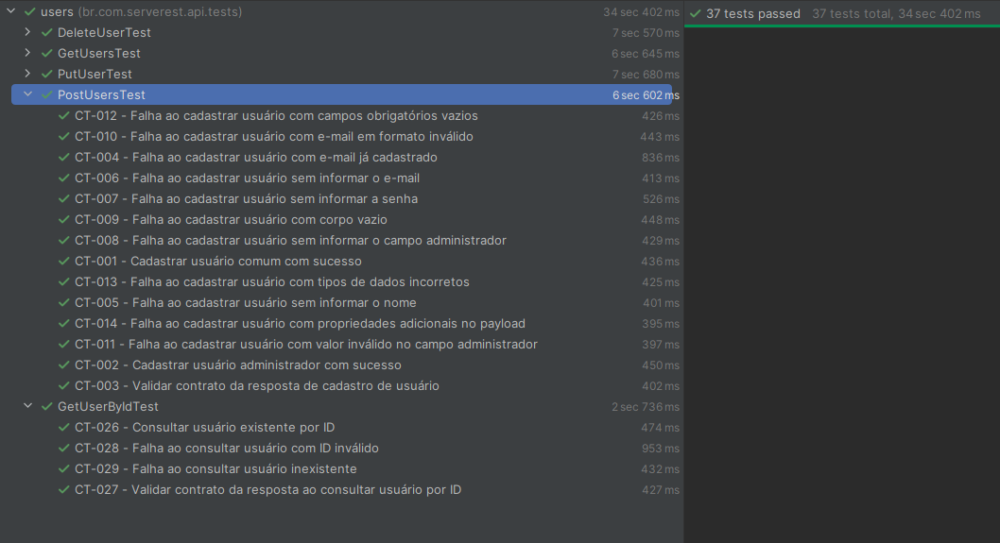
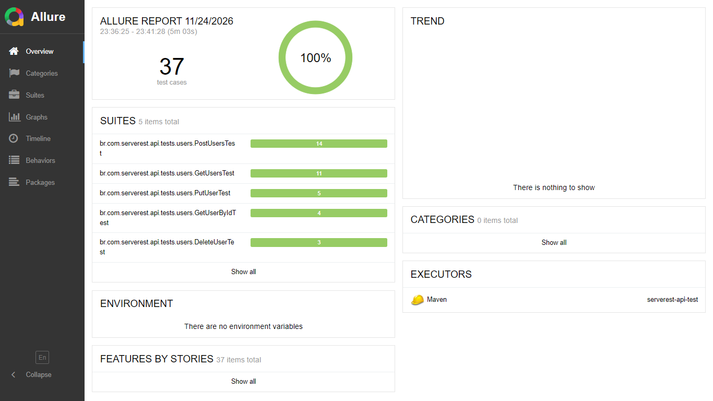

# ServeRest API Test

Projeto de automação de testes para a API REST de gerenciamento de usuários do [ServeRest](https://serverest.dev/).

## 1. Visão geral

A automação contempla as operações de gerenciamento de usuários, considerando cenários positivos e negativos, validações de contrato e regras de negócio aplicáveis às operações.

O projeto tem como objetivos:

- Validar o comportamento dos endpoints de gerenciamento de usuários.
- Verificar os códigos HTTP e o conteúdo das respostas.
- Validar campos obrigatórios, formatos e tipos de dados.
- Verificar regras de negócio e integridade dos registros.
- Automatizar cenários funcionais e validações de contrato.
- Gerar relatórios para análise dos resultados.

## 2. API e contrato

**Aplicação:** ServeRest
**Documentação:** https://serverest.dev/#/
**Contrato:** Swagger / OpenAPI
**URL base:** `https://serverest.dev`

As operações automatizadas são:

| Método | Endpoint | Finalidade |
|---|---|---|
| GET | `/usuarios` | Consultar usuários |
| POST | `/usuarios` | Cadastrar usuário |
| GET | `/usuarios/{_id}` | Consultar usuário por ID |
| PUT | `/usuarios/{_id}` | Atualizar ou cadastrar usuário |
| DELETE | `/usuarios/{_id}` | Excluir usuário |

## 3. Tecnologias utilizadas

| Tecnologia | Finalidade |
|---|---|
| Java 25 | Linguagem de programação |
| Maven | Gerenciamento de dependências e build |
| JUnit 5 | Organização e execução dos testes |
| REST Assured | Automação e validação de APIs REST |
| Hamcrest | Matchers para validações |
| Allure Report | Geração e visualização de relatórios |
| Git | Controle de versão |
| GitHub Actions | Integração contínua |

## 4. Estratégia de testes

Os cenários são organizados em três classificações:

- **Positivo:** operações válidas e resultados esperados de sucesso.
- **Negativo:** dados inválidos, ausência de informações obrigatórias e violações das regras de negócio.
- **Contrato:** validação da estrutura e conformidade das respostas.

As principais validações contemplam:

- **Funcional:** comportamento esperado de cada operação.
- **Contrato:** estrutura dos parâmetros, payloads e respostas.
- **Dados:** campos obrigatórios, formatos e tipos.
- **Regras de negócio:** duplicidade de e-mail, atualização e exclusão.
- **HTTP:** códigos de status e conteúdo das respostas.
- **Integridade:** consistência dos dados após operações de criação, atualização e exclusão.

Os testes utilizam dados preparados por meio de métodos auxiliares e fábricas de dados, com reutilização quando apropriado.

## 5. Escopo e cenários de teste

O projeto contempla os cinco endpoints de gerenciamento de usuários.

### POST `/usuarios` — Cadastro de usuários

| ID | Cenário | Classificação |
|---|---|---|
| CT-001 | Cadastrar usuário comum com sucesso | Positivo |
| CT-002 | Cadastrar usuário administrador com sucesso | Positivo |
| CT-003 | Validar contrato da resposta de cadastro de usuário | Contrato |
| CT-004 | Falha ao cadastrar usuário com e-mail já cadastrado | Negativo |
| CT-005 | Falha ao cadastrar usuário sem informar o nome | Negativo |
| CT-006 | Falha ao cadastrar usuário sem informar o e-mail | Negativo |
| CT-007 | Falha ao cadastrar usuário sem informar a senha | Negativo |
| CT-008 | Falha ao cadastrar usuário sem informar o campo administrador | Negativo |
| CT-009 | Falha ao cadastrar usuário com corpo vazio | Negativo |
| CT-010 | Falha ao cadastrar usuário com e-mail em formato inválido | Negativo |
| CT-011 | Falha ao cadastrar usuário com valor inválido no campo administrador | Negativo |
| CT-012 | Falha ao cadastrar usuário com campos obrigatórios vazios | Negativo |
| CT-013 | Falha ao cadastrar usuário com tipos de dados incorretos | Negativo |
| CT-014 | Falha ao cadastrar usuário com propriedades adicionais no payload | Negativo |

### GET `/usuarios` — Consulta de usuários

| ID | Cenário | Classificação |
|---|---|---|
| CT-015 | Consultar todos os usuários cadastrados sem aplicar filtros | Positivo |
| CT-016 | Validar contrato da resposta ao consultar usuários | Contrato |
| CT-017 | Consultar usuários filtrando por ID | Positivo |
| CT-018 | Consultar usuários filtrando por nome | Positivo |
| CT-019 | Consultar usuários filtrando por e-mail | Positivo |
| CT-020 | Consultar usuários filtrando por senha | Positivo |
| CT-021 | Consultar usuários administradores | Positivo |
| CT-022 | Consultar usuários não administradores | Positivo |
| CT-023 | Consultar usuários combinando filtros de nome e e-mail | Positivo |
| CT-024 | Consultar usuários sem registros correspondentes aos filtros informados | Positivo |
| CT-025 | Falha ao consultar usuários com e-mail em formato inválido no filtro | Negativo |

### GET `/usuarios/{_id}` — Consulta de usuário por ID

| ID | Cenário | Classificação |
|---|---|---|
| CT-026 | Consultar usuário existente por ID | Positivo |
| CT-027 | Validar contrato da resposta ao consultar usuário por ID | Contrato |
| CT-028 | Falha ao consultar usuário com ID inválido | Negativo |
| CT-029 | Falha ao consultar usuário inexistente | Negativo |

### PUT `/usuarios/{_id}` — Atualização ou cadastro de usuário

| ID | Cenário | Classificação |
|---|---|---|
| CT-030 | Atualizar usuário existente e validar persistência | Positivo |
| CT-031 | Cadastrar usuário quando o ID informado não existe (upsert) | Positivo |
| CT-032 | Rejeitar atualização com campos obrigatórios vazios e preservar o registro | Negativo |
| CT-033 | Rejeitar atualização com e-mail já utilizado e preservar o registro | Negativo |
| CT-034 | Rejeitar atualização com tipos de dados incorretos e preservar o registro | Negativo |

### DELETE `/usuarios/{_id}` — Exclusão de usuário

| ID | Cenário | Classificação |
|---|---|---|
| CT-035 | Excluir usuário existente e confirmar ausência posterior | Positivo |
| CT-036 | Validar exclusão com ID inválido conforme comportamento observado | Negativo |
| CT-037 | Tentar excluir usuário inexistente e confirmar ausência do registro | Negativo |

## 6. Arquitetura do projeto

A arquitetura busca manter a automação organizada, legível e de fácil manutenção, com responsabilidades separadas entre configuração, suporte, dados e cenários de teste.

### Componentes e responsabilidades

- **BaseAPI:** configuração compartilhada para a execução dos testes de API.
- **CreateUser:** suporte à criação e preparação de usuários utilizados nos testes.
- **GetUser:** centralização de consultas e validações reutilizadas de usuários.
- **UserDataFactory:** criação e preparação dos dados utilizados nos cenários.
- **Tests:** classes responsáveis pelos cenários automatizados e suas validações.
- **Resources:** armazenamento de schemas utilizados nas validações de contrato.
- **Allure:** geração dos resultados e relatórios de execução.

### Estrutura de diretórios

```text
serverest-api-test/
├── .github/
│   └── workflows/
│       └── api-tests.yml
├── docs/
│   └── evidencias/
│       ├── allure-report.png
│       ├── intellij-execucao-1.png
│       └── intellij-execucao-2.png
├── src/
│   └── test/
│       ├── java/
│       │   └── br/com/serverest/api/
│       │       ├── factory/
│       │       │   └── UserDataFactory.java
│       │       ├── support/
│       │       │   ├── BaseAPI.java
│       │       │   ├── CreateUser.java
│       │       │   └── GetUser.java
│       │       └── tests/
│       │           └── users/
│       │               ├── PostUsersTest.java
│       │               ├── GetUsersTest.java
│       │               ├── GetUserByIdTest.java
│       │               ├── PutUserTest.java
│       │               └── DeleteUserTest.java
│       └── resources/
│           ├── allure.properties
│           └── schemas/
│               └── users/
│                   ├── create-user-success.json
│                   ├── get-user-by-id-success.json
│                   └── get-users-success.json
├── .gitignore
├── pom.xml
└── README.md
```

## 7. Pré-requisitos e instalação

Para executar o projeto, são necessários:

- JDK 25.
- Maven 3.9 ou superior.
- Git.
- Acesso à internet para comunicação com a API ServeRest e obtenção das dependências.

### Clonar o repositório

```bash
git clone https://github.com/LevyMarcelo/serverest-api-test
cd serverest-api-test
```

### Instalar dependências e compilar os testes

```bash
mvn clean test-compile
```

## 8. Execução dos testes

### Executar todos os testes

```bash
mvn clean test
```

### Executar uma classe de teste específica

**Cadastro de usuários:**

```bash
mvn test -Dtest=PostUsersTest
```

**Consulta de usuários:**

```bash
mvn test -Dtest=GetUsersTest
```

**Consulta de usuário por ID:**

```bash
mvn test -Dtest=GetUserByIdTest
```

**Atualização de usuários:**

```bash
mvn test -Dtest=PutUserTest
```

**Exclusão de usuários:**

```bash
mvn test -Dtest=DeleteUserTest
```

## 9. Relatórios

O projeto utiliza Allure Report para organizar e apresentar os resultados das execuções.

Os resultados brutos são armazenados em:

```text
target/allure-results/
```

### Gerar e abrir o relatório

Após executar os testes, utilize:

```bash
mvn allure:serve
```

O comando gera e disponibiliza o relatório Allure localmente no navegador.

## 10. Resultados e evidências

Na última execução completa da suíte, foram obtidos os seguintes resultados:

| Indicador | Resultado |
|---|---:|
| Testes executados | 37 |
| Aprovados | 37 |
| Falhas | 0 |
| Erros | 0 |
| Ignorados | 0 |

### Distribuição por classe

| Classe de teste | Quantidade |
|---|---:|
| PostUsersTest | 14 |
| GetUsersTest | 11 |
| GetUserByIdTest | 4 |
| PutUserTest | 5 |
| DeleteUserTest | 3 |
| **Total** | **37** |

### Evidências da execução

**Execução dos testes — IntelliJ IDEA**

**Evidência 1 — Resultado da execução dos testes**



**Evidência 2 — Detalhes da execução dos testes**



**Relatório — Allure Report**

**Evidência 3 — Visão geral do relatório Allure**



## 11. Integração contínua — GitHub Actions

O projeto utiliza GitHub Actions para automatizar a execução dos testes.

A pipeline contempla:

- Preparação do ambiente Java.
- Instalação das dependências.
- Execução dos testes automatizados.
- Disponibilização dos resultados de execução como artefatos.

## 12. Observações

- A API ServeRest é um serviço externo, portanto sua disponibilidade e comportamento podem sofrer alterações.
- Os testes que realizam cadastros podem deixar registros persistentes no ambiente público após a execução.
- A API possui limite de 100 requisições por minuto. As execuções devem respeitar essa restrição.
- Não são realizados testes de carga ou volume contra o ambiente público.
